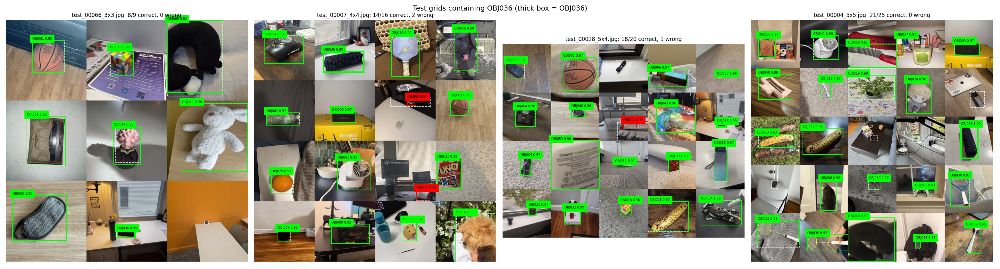

# Object Identification and Detection for Class Attendance

IE 7615 Deep Learning for AI (Northeastern University) — Discriminative Deep Learning Project, Group 2

Each student in the class photographed one personal object, which gives 73 object IDs (OBJ001–OBJ073). The goal is an automated attendance system: first **identify** which object is in a single photo, then **find and locate every object** in an image that contains many of them.

**Members:** Yi-Fan Liu, Pooja Yogesh Patil, Hiral Hitesh Rana, Wen-Hsin Su

## Results

| Task | Final model | Test result |
|---|---|---|
| Single-object ID (73 classes) | EfficientNetB0, two-stage fine-tuning | **97.4% accuracy**, macro F1 0.974 |
| Multi-object detection and location | YOLOv8s (11.2 M parameters, `imgsz=1120`) | **mAP@0.5 0.926**, mAP@0.5:0.95 0.870, precision 0.915, recall 0.911 (150 test grids, 2,220 objects) |

**YOLOv8s is the final model.** EfficientNetB0 is very accurate but can only give one ID per image; it cannot say where an object is or handle many objects. YOLOv8s does both demo tasks with one model.

Full write-ups: [Milestone 1 report](reports/Milestone1_Report.pdf) · [Milestone 2 report](reports/Milestone2_Report.pdf)



## Milestone 1: Single-object image ID

73-class image classification. We used 6,964 object images, split 70 / 15 / 15 (stratified, seed 42) into 4,874 train, 1,045 validation and 1,045 test images. Background-only photos (`*_bg_*`) are excluded.

All five models are built, trained and evaluated in [`milestone1/Week1_CNN_Comparison.ipynb`](milestone1/Week1_CNN_Comparison.ipynb).

| Model | Type | Val acc | Test acc | Top-5 | Macro F1 | Params (M) |
|---|---|---|---|---|---|---|
| **EfficientNetB0** (selected) | Transfer learning, fine-tuned from `block6a` | 98.2% | **97.4%** | 99.7% | 0.974 | 4.14 |
| ResNet50 | Transfer learning, fine-tuned `conv5` | 97.5% | 97.0% | 99.6% | 0.970 | 23.74 |
| MobileNetV2 | Transfer learning, fine-tuned from `block_13` | 96.2% | 96.2% | 99.3% | 0.962 | 2.35 |
| VGG16 | Transfer learning, fine-tuned `block5` | 95.5% | 95.0% | 98.7% | 0.950 | 14.75 |
| Custom CNN | From scratch (5 × Conv-BN-ReLU-MaxPool) | 77.0% | 78.5% | 92.6% | 0.785 | 1.61 |

The final model was chosen by validation accuracy; the test set was used only for reporting.

## Milestone 2: Multi-object detection and location

Multi-object images are grids of 224 × 224 photos placed side by side: 2×2, 3×3, 4×4, 5×4 and 5×5.

1. **Clean the photos.** Background shots and one wrong photo are excluded, the EXIF rotation is applied, and 16 exact duplicates are removed **before** splitting. This leaves 6,947 unique photos: 4,862 train, 1,042 validation, 1,043 test.
2. **Create bounding boxes.** The shared dataset only has class labels. Each photo shows one object, so two open-vocabulary detectors, **YOLO-World v2** and **Grounding DINO**, were prompted with the object's name and their boxes combined. They agreed on 76% of the photos (mean IoU 0.944 when they agreed). 6,598 photos were used and 349 were left out.
3. **Build grid images.** 800 train, 150 validation and 150 test grids. Train grids use only train photos, and the same for validation and test, so no photo leaks between splits.
4. **Train YOLOv8s** from COCO-pretrained weights: `imgsz=1120`, batch 8, 50 epochs, about 41 minutes on a T4 GPU.

Milestone 2 test result (before the label review below): mAP@0.5 0.909, mAP@0.5:0.95 0.850, precision 0.902, recall 0.896.

## Milestone 3: Final model, error analysis and live demo

The weakest object IDs pointed to wrong or missing boxes, so the labels were reviewed in four rounds (34 boxes corrected, OBJ010 relabelled as pairs, 203 photos left out) and YOLOv8s was retrained each time.

| Model | Precision | Recall | mAP@0.5 | mAP@0.5:0.95 |
|---|---|---|---|---|
| 1. Before label fixes | 0.918 | 0.879 | 0.907 | 0.849 |
| 2. 22 boxes corrected | 0.920 | 0.877 | 0.909 | 0.846 |
| 3. Label review | 0.917 | 0.885 | 0.903 | 0.844 |
| 4. Pencil case + sneaker pairs | 0.919 | 0.906 | 0.924 | 0.866 |
| **5. UNO boxes (final)** | **0.915** | **0.911** | **0.926** | **0.870** |

Final model by grid size (test set):

| Grid | Images | Objects | Precision | Recall | mAP@0.5 | mAP@0.5:0.95 |
|---|---|---|---|---|---|---|
| 2×2 (448×448) | 30 | 120 | 0.836 | 0.840 | 0.916 | 0.836 |
| 3×3 (672×672) | 30 | 270 | 0.942 | 0.881 | 0.934 | 0.890 |
| 4×4 (896×896) | 30 | 480 | 0.935 | 0.899 | 0.931 | 0.887 |
| 5×4 (1120×896) | 30 | 600 | 0.910 | 0.896 | 0.917 | 0.871 |
| 5×5 (1120×1120) | 30 | 750 | 0.927 | 0.885 | 0.931 | 0.875 |

**Live demo rule.** In a live demo run, five objects were missed although the model had found each of them with the right ID and box, only with a score of 0.18–0.32. A lower global threshold finds them but adds about as many wrong boxes. Each grid cell holds exactly one object, so the demo instead keeps only the most confident box in each cell if it is above a floor. The floor is chosen on the validation grids (best F1), not on the test set.

## Repository contents

```
reports/
├── Milestone1_Report.pdf                 # CNN comparison report
└── Milestone2_Report.pdf                 # multi-object detection report
notebooks/
└── Final_Notebook_Milestones_1-3.ipynb   # final notebook: Part 1 CNNs, Part 2 labelling + YOLOv8s, Part 3 results + live demo
milestone1/
├── Week1_CNN_Comparison.ipynb            # data pipeline, 5 CNNs, training, evaluation, error analysis
└── results/                              # metrics per model, split, per-class report, figures
milestone2/
└── results/                              # Milestone 2 run (before the label review)
    ├── week2_summary.json                # photo counts, label agreement, training settings, test metrics
    ├── test_metrics_*.csv                # by grid size, by object ID, at confidence 0.5
    ├── labels/                           # bounding box per photo and label status per object
    ├── training/                         # YOLOv8s training curves and settings
    └── figures/                          # grid examples, detections, errors, confusion matrix
```

## How to run

The notebooks run on **Google Colab with a T4 GPU**.

1. Put the class dataset as `database.zip` in your Google Drive (one folder per object: `database/images_OBJxxx/`). The dataset is **not included** because it is the class's shared photo collection.
2. In the first setup cell, set the Drive folder that contains `database.zip`.
3. Part 1 (TensorFlow, about 70 minutes of training) and Parts 2–3 (PyTorch / Ultralytics, about 2 hours) each have their own setup cell. **After Part 1, use Runtime → Restart session, then run from Part 2**, because TensorFlow keeps the GPU memory.
4. For the live demo only, run the single cell in section 3.4. It loads the saved final model and asks you to upload images.

Built with TensorFlow 2.20 / Keras 3 (Part 1) and Ultralytics 8.4 / PyTorch 2.11 (Parts 2–3). See [`requirements.txt`](requirements.txt).

**Notes**
- Trained model files (`.keras` 19–206 MB, YOLOv8s `.pt` 22 MB) are not included. Running the notebooks recreates them.
- The latency column in `model_comparison.csv` was measured with single-image calls on the GPU, which mostly reflects layer count. `model_comparison_cpu_latency.csv` adds a single-image CPU latency on a laptop (Intel i5), which is a fairer speed comparison.
- The final notebook is large (about 36 MB) because of its saved outputs. If GitHub does not display it, download it or open it in Colab.
